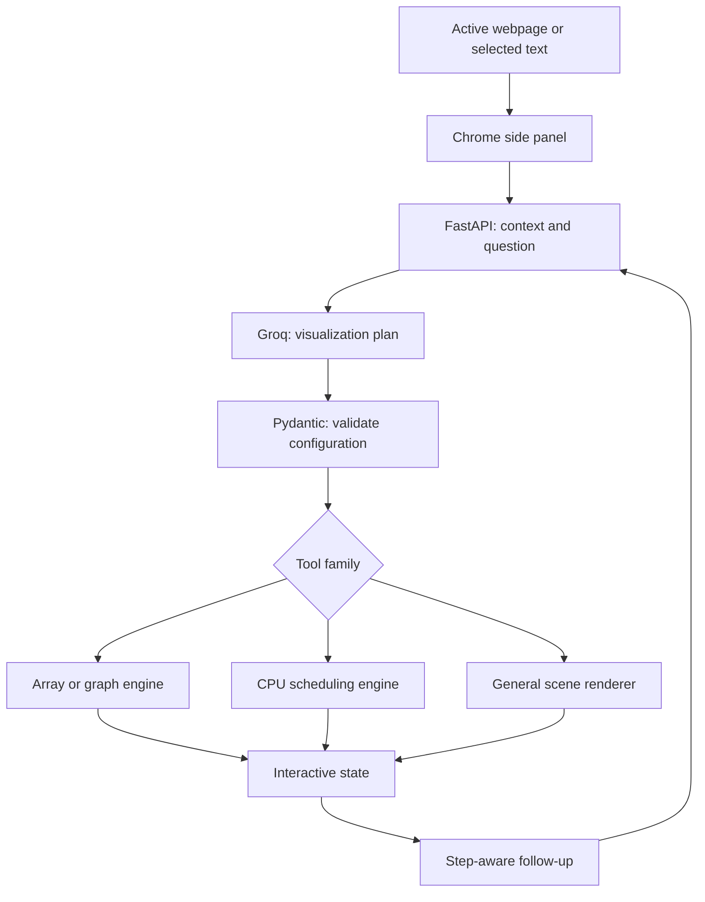

<div align="center">

# Askly

### Read the page. Ask the question. Explore the idea.

**AI-powered browser extension that transforms webpages into interactive learning experiences with contextual explanations, visualizations, and algorithm comparisons.**

[](https://react.dev/)
[](https://www.typescriptlang.org/)
[](https://fastapi.tiangolo.com/)
[](https://console.groq.com/)
[](https://developer.chrome.com/docs/extensions/)

**Page-aware explanations · AI-selected tools · Algorithm comparisons · CPU scheduling · General concept visuals**

[Get started](#get-started) · [Explore the tools](#the-toolbox) · [Architecture](#how-it-works) · [Development](#development-and-tests) · [Limitations](#current-boundaries)

</div>

---

Askly brings interactive learning directly into your browser. It uses webpage context and your questions to select visualization tools, explain concepts, compare approaches, and answer follow-up questions about the displayed steps. Built with React, TypeScript, FastAPI, and Groq.

## A webpage is the starting point

You are reading about binary search. The explanation makes sense until you ask:

> How is this different from linear search?

Askly uses the page and your question to suggest a comparison. Open both visualizers, use the same array and target, and step through what each algorithm actually does.

Reading about CPU scheduling instead? The relevant tool is a Gantt chart, with a ready queue and waiting-time calculations. Reading about a concept without a dedicated simulator? Askly can generate an explanatory scene with nodes, connections, and staged highlights.

**The page supplies context. Your question supplies intent. The planner selects the tool.**

## What you can do

| Action | What happens |
| --- | --- |
| **Read page** | Attach selected text or rendered article content from the active tab. |
| **Visualize this page** | Ask the AI to identify concepts and propose relevant visuals. |
| **Ask & explore** | Ask a question, request a comparison, or explore a topic beyond the page. |
| **Open visual** | Open one proposed tool with the generated configuration. |
| **Compare visually** | Explore multiple tools with shared examples and playback where supported. |
| **Explain this step** | Pause playback and ask about the exact state currently displayed. |
| **Manual playground** | Explore the existing algorithm controls directly, without AI planning. |

Selected text takes priority over the rest of the page. When no selection exists, extraction tries `article`, then `main`, then the page body. Content is bounded to 24,000 characters; the planner receives a smaller excerpt.

## Try these conversations

### Compare two approaches

> How is binary search different from linear search? Use the same input for both.

**Expected experience:** a short explanation, visual suggestions, and a comparison using a common sorted array and target. Shared playback shows each algorithm's state; search tools also show candidates inspected.

### Turn a scheduling example into execution

> Compare FCFS and Round Robin. P1 arrives at 0 with burst 5, P2 at 1 with burst 3, and P3 at 2 with burst 1. Use quantum 2.

**Expected experience:** scheduling tools configured from the request, Gantt charts, remaining work, ready queues, and completion/waiting/turnaround/response metrics.

### Understand a concept without a dedicated simulator

> Show how a TCP connection is established.

**Expected experience:** an AI-generated explanatory visual with labelled concepts, connections, and a sequence of highlighted scenes.

### Ask a contextual follow-up

> How is it different from Dijkstra?

**Expected experience:** the planner receives the previous question, previous answer, visual topic titles, and current page context. If the referent is unclear, it is instructed to ask for clarification. A* currently uses a general explanation rather than a dedicated A* simulator.

These describe intended interactions, not a guarantee that every generated explanation is correct. Tool selection and general visual quality depend on the model.

## The toolbox

### 1. Arrays, sorting, and searching

| Category | Supported algorithms |
| --- | --- |
| Sorting | Bubble, Selection, Insertion, Merge, Quick Sort |
| Searching | Linear Search, Binary Search, Search in Rotated Sorted Array |

- Custom arrays and search targets.
- Play/pause, previous/next step, playback speed, and timeline scrubbing.
- Active elements, sorted positions, variables, and highlighted pseudocode.
- Complexity labels and comparison-event / candidate-inspection counts.
- Binary search input validation; rotated search currently requires distinct values.

### 2. Graph exploration

| Algorithm | Visible state |
| --- | --- |
| BFS | Queue, discovery order, and minimum-edge path |
| DFS | Stack, traversal order, and DFS-tree path |
| Dijkstra | Tentative distances, settled nodes, parents, and weighted shortest path |
| Topological sort | Indegrees, zero-indegree queue, ordering, and cycle detection |
| Kruskal + DSU | Considered/accepted/rejected edges, roots, parents, ranks, and forest weight |

Graphs support editable nodes, edges, weights, source/target, and directed mode. Algorithm preconditions are checked: topological sort requires directed edges; Kruskal requires undirected edges. The current graph tools accept non-negative weights.

### 3. CPU scheduling

**FCFS · SJF · SRTF · Priority · Preemptive Priority · Round Robin**

Every scheduler uses a local execution engine. The model chooses the configuration; TypeScript computes the schedule and metrics.

| Output | Meaning |
| --- | --- |
| Gantt chart | CPU execution intervals, including idle time |
| Ready queue | Processes waiting for CPU time |
| Remaining burst | Work still needed by each process |
| Completion time | When a process finishes |
| Turnaround time | Completion minus arrival |
| Waiting time | Turnaround minus burst |
| Response time | First dispatch minus arrival |

**Scheduling assumptions:** integer time units, zero context-switch overhead, smaller priority number means higher priority, and deterministic arrival/input-order tie breaking. Round Robin admits new arrivals at a quantum boundary before requeuing the expired process.

Processes and quantum are editable in individual scheduling tools. Comparisons require identical process inputs.

### 4. General concept visuals

For concepts outside the dedicated toolbox, the AI generates a structured scene:

- **Layouts:** flow, sequence, cycle, or comparison.
- **Nodes:** short, labelled concepts.
- **Connections:** directed relationships with optional labels.
- **Scenes:** explanations paired with active-node highlights.
- **Interaction:** playback and node selection to inspect connections.

> **General visuals are explanatory diagrams.** They do not provide arbitrary executable simulations or independently verify the underlying subject matter.

### Comparing fairly

Array comparisons validate a shared array and target. Scheduling comparisons validate shared processes. Arrays, schedules, and general scenes can use shared playback; graph tools retain independent controls.

**A shared playback step is not a runtime benchmark.** Different algorithms can perform different amounts of work per displayed step.

## How it works



### Two responsibilities, kept explicit

**The AI interprets intent.** It identifies concepts, proposes tools, configures examples, and generates explanations.

**The application executes supported tools.** Local algorithms produce sorting/searching traces, graph states, scheduling intervals, and calculated metrics. React renders those states.

General scenes use AI-authored explanatory data. Askly does not execute model-generated JavaScript, HTML, or SVG markup.

### The visualization contract

Plans use a Pydantic discriminated union with four tool identifiers:

| Identifier | Configuration |
| --- | --- |
| `array` | Algorithm, values, target |
| `graph` | Algorithm, nodes, weighted edges, direction, source, target |
| `schedule` | Algorithm, processes, quantum |
| `general` | Layout, nodes, links, scenes |

Validation covers input bounds, graph references, duplicate IDs/edges, algorithm preconditions, scene references, and shared comparison inputs. Generated examples are labelled **illustrative**; supplied examples are intended to retain their original values.

The planner requests schema-shaped output from Groq. If Groq rejects constrained generation with a recognized schema error, the provider layer can retry once in JSON mode. Local validation failures can trigger one repair request with field-level feedback. Authentication and rate-limit failures are not automatically retried.

If a repair still fails, Askly may retain a valid explanation and valid tools while labelling unavailable visuals. Structurally valid output can still be conceptually wrong.

### Page grounding

- Long pages are reduced to a bounded, keyword-ranked excerpt.
- Follow-up planning includes the previous question, answer, and visual topic titles.
- Claimed page quotations are retained only when they occur exactly in the supplied excerpt.
- Outside-page questions are allowed and labelled.

This is **context-based retrieval**, without an embedding model or vector database. It can miss relevant text. Selecting a focused paragraph improves precision.

## Stack

| Layer | Technology |
| --- | --- |
| Browser integration | Chrome Manifest V3, Side Panel API, scripting and tab APIs |
| Frontend | React 19, TypeScript, Vite |
| Visual rendering | SVG, CSS, and React components |
| Algorithm execution | Local TypeScript trace and scheduling engines |
| Backend | Python, FastAPI |
| AI provider | Groq chat completions; configurable model |
| Validation | Pydantic models and JSON Schema |
| HTTP client | HTTPX, including SOCKS support |
| Configuration | Environment variables through python-dotenv |
| Verification | Node test runner, Python unittest, React server-render integration checks |

The default model in code is `openai/gpt-oss-20b`; availability and quotas depend on the Groq account.

## Get started

### Requirements

- Node.js **24 recommended** for the existing TypeScript test command.
- Python **3.11+**.
- Chrome **116+** for the side panel.
- A Groq API key with access to the configured model.

### 1. Clone and build

```powershell
git clone https://github.com/AKSH4T-13/Askly.git
cd Askly
npm install
npm run build
```

Vite creates **`dist/`**, the folder Chrome loads as the extension.

### 2. Prepare the Python backend

From the project root:

```powershell
python -m venv venv
.\venv\Scripts\python.exe -m pip install -r backend/requirements.txt
```

Create `.env` only if it does not already exist:

```powershell
if (!(Test-Path .env)) { Copy-Item .env.example .env }
```

Set your local values:

```dotenv
GROQ_API_KEY=your_groq_api_key
GROQ_MODEL=openai/gpt-oss-20b
```

Keep `.env` private. It is ignored by Git.

### 3. Start the API

```powershell
.\venv\Scripts\python.exe -m uvicorn backend.main:app --host 127.0.0.1 --port 8000
```

Leave this terminal running. API documentation is available at **http://127.0.0.1:8000/docs** and health status at **http://127.0.0.1:8000/health**.

### 4. Load the extension

1. Open `chrome://extensions`.
2. Enable **Developer mode**.
3. Choose **Load unpacked**.
4. Select the generated **`dist`** folder.
5. Open a normal webpage and click the Askly toolbar icon.
6. Click **Read page**, then **Visualize this page** or **Ask & explore**.

The installed extension does **not** require `npm run dev`. AI requests require the Python backend; local visual playback does not require a new AI call.

### Updating after code changes

```powershell
npm run build
```

Reload Askly on `chrome://extensions`. For backend changes, stop the Python server with `Ctrl+C` and restart it. Reloading the extension alone does not reload Python code.

## Development and tests

### Standalone frontend

```powershell
npm run dev
```

Open the Vite URL printed in the terminal. This preview supports the UI and backend requests, but cannot extract content from another tab; webpage reading requires the installed extension.

For a different development backend:

```powershell
$env:VITE_API_URL = "http://127.0.0.1:8001"
npm run dev
```

Production defaults to port `8000`. Changing the extension's backend destination also requires matching host permissions and CORS settings.

### Verification commands

| Command | Coverage |
| --- | --- |
| `npm test` | Sorting/searching, graph algorithms, extraction, scheduling and accounting |
| `npm run test:render` | Server rendering across tool families and shared comparisons |
| `python -m unittest discover -s tests -p "test_*.py"` | Backend validation, context, evidence, schema repair and provider handling |
| `npm run build` | TypeScript checking and production bundle |
| `python -m backend.test_groq` | Optional live Groq smoke test; consumes API quota |

Unit and rendering checks are not a substitute for testing the installed Chrome extension or evaluating model accuracy.

### API surface

| Endpoint | Purpose |
| --- | --- |
| `GET /health` | Provider/configuration status without exposing the key |
| `POST /explore` | Page/question-driven visual planning |
| `POST /ask` | Explanation using supplied visual state and page context |
| `POST /configure` | Array configuration used by the manual playground |

### Code map

| Location | Responsibility |
| --- | --- |
| `src/main.tsx` | Primary page-driven experience and comparison orchestration |
| `src/ToolPlayer.tsx` | Tool dispatch, array/scheduling players, general scenes |
| `src/tools.ts` | Frontend visualization contracts |
| `src/algorithms.ts` | Sorting and searching traces |
| `src/graphs.ts` | Graph algorithms and DSU snapshots |
| `src/GraphLab.tsx` | Graph editor and playback |
| `src/scheduling.ts` | CPU scheduling and metrics |
| `src/pageContext.ts` | Page extraction and access recovery |
| `src/Manual.tsx` | Optional manual playground |
| `backend/main.py` | FastAPI routes, Groq requests, errors and bounded repair |
| `backend/planning.py` | Tool schemas, planner instructions and context selection |
| `extensions/` | Manifest and side-panel service worker |
| `tests/` | Algorithm, backend, provider and rendering checks |

## Privacy and execution

- The API key stays in the Python backend; it is not bundled into the extension.
- Attached page text stays in panel memory until an AI request sends the relevant context to Groq.
- Refreshing or reloading the panel resets its in-memory session.
- Page access recovery requests permission for the specific website through an explicit button.
- Chrome internal pages, the Chrome Web Store, and other restricted contexts cannot be read.
- The development API binds to localhost in the documented setup.
- Provider diagnostics avoid logging credentials or complete page content.

## Troubleshooting

| Symptom | Check |
| --- | --- |
| **Read page does nothing** | Reload the extension, open a normal article, and check the status/error beside the button. |
| **Page access expired** | Reopen Askly from the toolbar on the current tab, or use **Allow page access**. |
| **No readable content** | Wait for the page to load, or select the relevant paragraph. |
| **Cannot connect to Askly** | Start the backend on port `8000`. |
| **Rate limit reached** | Wait for quota recovery; reduce page scope and avoid repeated requests. |
| **Model not found / access denied** | Check `GROQ_MODEL` and access in the Groq account. |
| **Visual cannot be generated reliably** | The explanation may be usable while the tool configuration failed validation; try a focused concept and inspect safe backend diagnostics. |
| **Old interface after changes** | Rebuild `dist`, reload the extension, and reopen the side panel. |
| **New UI but old API behavior** | Restart the Python backend. |

## Current boundaries

Askly is an evolving prototype. Its strongest execution guarantees are in the dedicated local algorithms and their tested preconditions.

- General diagrams are model-authored explanations, not verified simulations.
- Schema compliance does not establish factual correctness or relevance.
- Long-page excerpt selection can omit useful context.
- Comparisons use shared playback, not measured execution performance.
- Graph comparisons retain independent controls.
- History and attached content are in memory; persistent sessions are not implemented.
- Exact quotation matching checks text occurrence, not whether a claim follows from that quotation.
- There is no unrestricted browser agent, arbitrary generated-code execution, or vector database.

## Roadmap

- [ ] Dedicated trees/BST and heap tools.
- [ ] Linked lists, stacks, and queues.
- [ ] Two pointers, sliding windows, and prefix sums.
- [ ] Recursion and backtracking traces.
- [ ] Source highlighting on the original page.
- [ ] Persistent page-wise sessions.
- [ ] A curated evaluation set for tool selection and explanation quality.
- [ ] More robust layouts for general explanatory visuals.

---

<div align="center">

**Understanding starts with a question. Askly gives you something to explore.**

Built by [Akshat Abhishek](https://github.com/AKSH4T-13)

</div>
